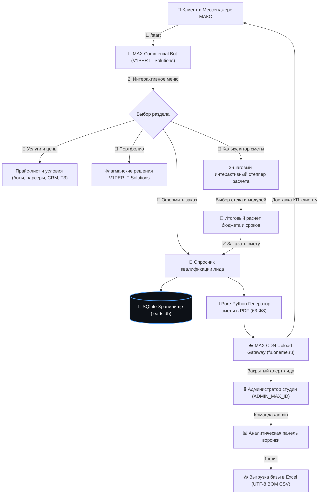

# 🤖 V1PER IT Solutions | Enterprise Commercial Messenger MAX Bot & Sales Platform

[-brightgreen.svg)](tests/)
[](https://www.python.org/)
[]()
[]()
[](https://dev.max.ru)
[](https://github.com/viper86rus-arch/MAX_Commercial_Bot)
[](LICENSE)

> **Автономный промышленный коммерческий чат-бот студии V1PER IT Solutions для официальной российской платформы Мессенджер МАКС (`platform-api2.max.ru`).**  
> Полный цикл автоматизации первичных продаж: 3-шаговый интерактивный калькулятор сметы, автоматическая генерация официальных коммерческих предложений в A4 PDF с векторным штампом усиленной квалифицированной электронной подписи (63-ФЗ РФ), изолированная панель администратора (`/admin`) со сквозной воронкой и выгрузкой в Excel CSV, и защищённые push-уведомления инженеру.

---

## 📋 Архитектурный поток (FSM & PDF Generation)



---

## 🌟 Ключевые возможности и инженерные решения

1. **Clean Zero-Pip Architecture (Чистый Python Standard Library)**:
   * Ядро бота, сетевой клиент и генератор документов построены исключительно на стандартной библиотеке Python (`urllib.request`, `sqlite3`, `json`, `dataclasses`).
   * Внешние pip-пакеты не требуются — запуск "из коробки" на любой системе без риска конфликтов зависимостей.

2. **Официальный стек Мессенджера МАКС 2026 года**:
   * Интеграция с официальным шлюзом `https://platform-api2.max.ru` с поддержкой сертификатов Минцифры РФ (`russian_trusted_root_ca.pem`).
   * Поддержка Long Polling и Webhook-режимов с надёжной обработкой `callback`-событий и санитизацией payload.

3. **🧮 3-шаговый интерактивный калькулятор сметы (`_handle_calculator`)**:
   * Пошаговый конфигуратор: выбор типа системы (Telegram/MAX бот, парсер маркетплейсов, ТЗ, автоматизация), выбор БД и доп. модулей (эквайринг, админ-панель).
   * Автоматический расчёт бюджета и сроков с мгновенным переносом параметров в форму заказа.

4. **📄 Pure-Python генератор коммерческих предложений с ЭЦП (63-ФЗ)**:
   * Векторный рендеринг PDF 1.4 A4 с системным TrueType-шрифтом Roboto.
   * Синий штамп простой электронной подписи (ПЭП, 63-ФЗ) с уникальным криптографическим хэшем SHA-256 документа.
   * Прямая загрузка на CDN МАКС (`fu.oneme.ru`) и нативная отправка PDF-файла клиенту прямо в чат.

5. **🔒 Закрытая панель администратора (`/admin`)**:
   * Строгая авторизация по `ADMIN_MAX_ID`: обычным пользователям панель недоступна.
   * Метрики в реальном времени: количество лидов, новые заявки, подтверждённые заказы и прогнозируемая выручка (₽).
   * Мгновенный экспорт актуального реестра заказов в `.csv` с кодировкой `UTF-8 с BOM` (`utf-8-sig`) и русскими разделителями `;` для безупречного открытия в Microsoft Excel.

6. **🚨 Защищённые алерты лидов**:
   * При оформлении заказа ведущий инженер мгновенно получает уведомление в МАКС и Telegram с контактами клиента, сметой и прикреплённым PDF-документом.

---

## 🏗 Архитектура проекта

```text
MAX_Commercial_Bot/
├── bot.py                  # Главный диспетчер Long Polling/Webhook, FSM и меню
├── max_api.py              # Клиент MAX Bot API 2026 (сообщения, колбэки, загрузка файлов)
├── pdf_generator.py        # Векторный генератор PDF-смет с цифровой подписью (63-ФЗ)
├── database.py             # SQLite3 CRM, воронка и экспорт в Excel CSV (UTF-8 BOM)
├── config.py               # Конфигурация из .env (токены, ADMIN_MAX_ID, пути)
├── tests/
│   └── test_max_bot.py     # Модульные тесты (FSM, калькулятор, PDF, экспорт)
├── exports/                # Сгенерированные выгрузки реестра заказов
├── proposals/              # Сгенерированные клиентские сметы в PDF
├── .env.example            # Шаблон переменных окружения
├── .gitignore              # Исключение секретов, баз данных и файлов
└── README.md               # Документация проекта
```

---

## 🛠️ Быстрый старт

### 1. Настройка конфигурации
```bash
cp .env.example .env
# Заполните MAX_BOT_TOKEN и ADMIN_MAX_ID
```

### 2. Запуск в интерактивном демо-режиме (без токена)
```bash
python bot.py --demo
```

### 3. Запуск промышленного сервиса
```bash
python bot.py
```

### 4. Экспорт заявок в CSV для бухгалтерии
```bash
curl http://localhost:8080/export
```
Либо нажмите кнопку **«📥 Выгрузить Excel (CSV)»** прямо в закрытом чате администратора (`/admin`).

---

## 🧪 Модульное тестирование

Проект покрыт автономным тестовым комплексом (9/9 тестов):
```bash
python3 -m unittest discover -s tests -v
```

---

## 🖥️ Поддерживаемые операционные системы

* Linux (Ubuntu, Debian, RHEL)
* macOS
* Windows Server

---

## 📄 Лицензия и авторство

* **Автор разработки:** V1PER ([`viper86rus-arch`](https://github.com/viper86rus-arch))
* **Лицензия:** [MIT License](LICENSE) (2026) — открытый исходный код без ограничений на коммерческое и образовательное применение.
