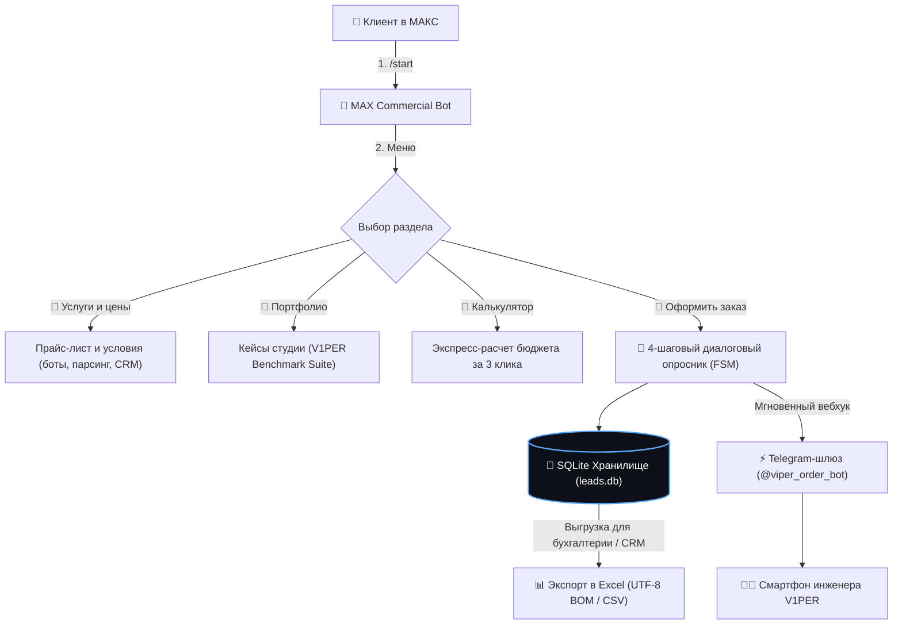

# 🤖 MAX Commercial Bot: Промышленный чат-бот для бизнеса в мессенджере МАКС

[](LICENSE)
[](https://www.python.org/)
[]()
[](https://dev.max.ru)

Автономный промышленный коммерческий чат-бот на **Python** для официальной корпоративной платформы **МАКС** (`platform-api2.max.ru`), реализующий автоматизацию первичных продаж, экспресс-расчет сметы, квалификацию лидов и мгновенную трансляцию заявок в Telegram инженера.

---

## 📋 Архитектурный поток (FSM & Уведомления)



---

## 🚀 Ключевые преимущества и особенности

1. **Clean Zero-Pip Architecture (Чистый Python)**:
   * Ядро бота, сетевой клиент и HTTP-сервер построены исключительно на стандартной библиотеке Python (`http.server`, `urllib.request`, `sqlite3`, `json`).
   * Нулевое количество уязвимостей сторонних зависимостей.
2. **Официальный стек МАКС 2026 года**:
   * Интеграция с официальным шлюзом `https://platform-api2.max.ru`.
   * Авторизация прямым токеном `Authorization: <token>` в соответствии со спецификацией `MAX Messenger Agent Skill`.
3. **Двухуровневая фиксация лидов**:
   * **Локальный уровень:** гарантированное сохранение в базу SQLite с отслеживанием статусов.
   * **Мгновенный уровень:** пуш-уведомление в Telegram разработчика с полными данными клиента (имя, контакт, бюджет, техзадание).
4. **Excel-совместимый экспорт (Microsoft Excel / CRM)**:
   * Экспорт заявок в формате CSV с маркером байтовой последовательности UTF-8 BOM (`utf-8-sig`) и разделителем точка с запятой (`;`).
5. **Встроенный оффлайн-эмулятор (`--demo`)**:
   * Позволяет проводить демонстрацию заказчикам и тестировать весь диалоговый цикл в терминале без реального токена.

---

## 🛠️ Быстрый старт

### 1. Клонирование и настройка
```bash
cp .env.example .env
# Отредактируйте параметры MAX_BOT_TOKEN и TG_NOTIFY_BOT_TOKEN
```

### 2. Запуск в интерактивном демо-режиме (без токена)
```bash
python bot.py --demo
```

### 3. Запуск вебхук-сервера в продакшене
```bash
python bot.py
```

### 4. Экспорт заявок в CSV для заказчика
```bash
curl http://localhost:8080/export
```

---

## 🧪 Модульное тестирование

Запуск тестового набора (FSM, SQLite, экспорт BOM, диалоги):
```bash
python -m unittest discover -s tests -v
```

---

## 🖥️ Поддерживаемые операционные системы

* Linux (Ubuntu, Debian, RHEL)
* macOS
* Windows Server

---

## 📄 Лицензия и авторство

* **Автор разработки:** V1PER ([`viper86rus-arch`](https://github.com/viper86rus-arch))
* **Лицензия:** [MIT License](LICENSE) (2026) — открытый исходный код без ограничений на коммерческое и образовательное применение.
